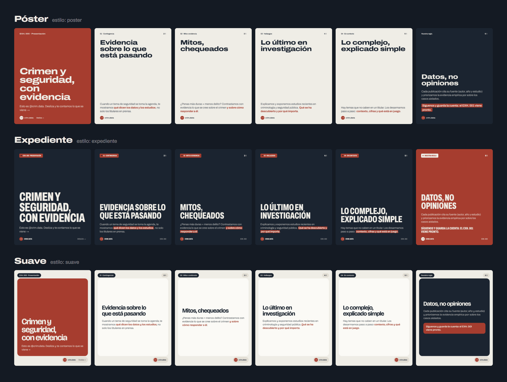

<p align="center"></p>

<h1 align="center">crim.data studio</h1>

<p align="center">Escribes el contenido de cada lámina en un archivo de texto y el estudio arma los PNG para Instagram con el diseño de <b>@crim.data</b>, gráficos incluidos. Cada vez que suben cambios, GitHub los compila solo.</p>

<p align="center"></p>

<p align="center"><b><a href="https://github.com/joaquinvapasten/crimdata-studio/tree/png">Ver las láminas compiladas →</a></b> · <a href="marca/">Marca: logo, paleta y tipografías</a></p>

---

## Empezar

Necesitas **Python 3.10+** y **Google Chrome** o **Microsoft Edge** (el estudio los usa para "fotografiar" las láminas).

**Windows:** doble clic en `estudio.bat`. La primera vez instala lo necesario y después abre la vista previa en el navegador.

**Terminal (cualquier sistema):**

```bash
python -m venv .venv
.venv\Scripts\activate          # macOS/Linux: source .venv/bin/activate
pip install -r requirements.txt
python -m studio                # vista previa en vivo
```

> Si no tienes Chrome ni Edge: `python -m playwright install chromium`.
> En Windows, clona el repo en una ruta corta (ej. `C:\Users\tu-usuario\crimdata-studio`): Playwright tiene archivos con nombres largos.

## El día a día

| Quiero… | Comando (o `estudio.bat …`) |
|---|---|
| Ver y editar con vista previa en vivo | `python -m studio` |
| Crear el siguiente post (numera el EXH solo) | `python -m studio nuevo "Mitos sobre las penas"` |
| Crear un gráfico suelto | `python -m studio grafico "Homicidios 2015-2023"` |
| Pasar un borrador de Word al formato del estudio | `python -m studio importar borrador.docx` |
| Generar todos los PNG sin vista previa | `python -m studio compilar` |
| Regenerar la hoja de marca | `python -m studio marca` |

En modo en vivo, **cada vez que guardas** un `.md` se recompila y la galería del navegador se actualiza sola. Desde ahí puedes ampliar las láminas (← →), copiar el texto del post y abrir la carpeta con los PNG.

Los PNG quedan en `salida/`, **una carpeta por estilo** con todos los posts adentro:

```
salida/poster/000-presentacion/01.png … 06.png  + texto.txt (caption y hashtags)
salida/poster/001-gobernanza-criminal/…
salida/expediente/000-presentacion/…
salida/suave/000-presentacion/…
salida/graficos/nombre-del-grafico.png
```

## Estilos

Hay tres. **Mientras no elijamos uno, cada post sale en los tres** (una carpeta por estilo) para compararlos lado a lado. La línea `estilo:` del encabezado lo controla:

| `estilo:` | Sale en |
|---|---|
| `todos` (o no poner la línea) | los tres |
| `poster` | solo póster |
| `[poster, suave]` | esos dos |

Los gráficos sueltos de `graficos/` salen en `poster` si no dicen otra cosa.

| `estilo:` | Cómo se ve |
|---|---|
| `poster` | Archivo extendida, título arriba y texto abajo, fondo piedra. Limpio y contundente. |
| `expediente` | Mayúsculas condensadas sobre tinta, etiqueta de evidencia y énfasis como tachón de color. Tono documental. |
| `suave` | Bricolage Grotesque en tarjetas redondeadas, con píldoras arriba y abajo. |

## Cómo se escribe un post

Un post es un archivo en `posts/`. Arriba va el encabezado; las láminas se separan con `---`.

```markdown
---
exh: "001"
tema: Mitos sobre las penas
estilo: todos
formato: "4:5"
texto: |
  El caption de la publicación.
hashtags: "#criminología #seguridadpública #evidencia #Chile"
---

# ¿Penas más duras, menos delito?
Lo que dice la evidencia →

---

etiqueta: 01 · El mito
# Subir las penas disuade
Es la respuesta más común, pero **la certeza del castigo pesa más que su severidad**.
fuente: Nagin, D. (2013). Deterrence in the Twenty-First Century.

---

tipo: cierre
etiqueta: En resumen
# Certeza antes que severidad
> Guarda este post y compártelo con quien siga creyendo lo contrario.
```

**Dentro de una lámina**

| Escribes | Sale |
|---|---|
| `# Título` | Título |
| `## Bajada` | Subtítulo grande |
| `### Rótulo` | Rótulo chico sobre el título |
| Texto normal | Párrafo (un salto de línea = salto de línea) |
| `**negrita**` | Énfasis (en ladrillo; en `expediente`, tachón de color) |
| `*cursiva*` · `==marcado==` | Cursiva · fondo de marcador |
| `- ítem` · `1. ítem` | Lista con guion · lista numerada |
| `> texto` | Destacado (en el cierre, el recuadro del llamado final) |
| `\| tabla \|` | Tabla (las columnas numéricas se alinean solas) |
| `` | Imagen |
| ` ```grafico ` | Gráfico (ver abajo) |

**Directivas** (una línea `clave: valor`, en cualquier parte de la lámina)

| Directiva | Qué hace |
|---|---|
| `etiqueta:` | Texto de arriba a la izquierda (`01 · Contingencia`) |
| `tipo:` | `portada` · `texto` · `cifra` · `cita` · `grafico` · `cierre` |
| `fondo:` | `piedra` · `tinta` · `ladrillo` · `musgo` |
| `fuente:` | Cita la fuente al pie de la lámina |
| `nota:` | Letra chica al final del contenido |

Casi nunca hace falta `tipo:`: la primera lámina es la **portada**, una lámina con gráfico es **grafico** y el resto es **texto**. Cada estilo elige el fondo de cada tipo (en `poster` y `suave` la portada va en ladrillo y el cierre en tinta; en `expediente` todo va en tinta y el cierre en ladrillo), y `fondo:` lo cambia en una lámina puntual. Para un dato grande usa `tipo: cifra` y escribe la cifra como título (`# 3 de 10`). Para una cita, `tipo: cita` con `> la cita` y el autor en la línea siguiente.

Formatos: `4:5` (1080×1350, el recomendado para carruseles) · `1:1` · `3:4` · `9:16` (historias).

El numerado `02 / 06`, el `EXH. 000`, la firma y el ajuste de tamaño son automáticos: si un texto no cabe, la letra se achica sola y, si se achica demasiado, la galería te avisa.

`posts/muestrario.md` tiene un ejemplo de cada tipo de lámina. Úsalo de referencia y bórralo cuando quieras.

## Gráficos

Van dentro de cualquier lámina en un bloque ` ```grafico `. Para un gráfico suelto (una sola imagen), crea el archivo en `graficos/` con `python -m studio grafico "Nombre"`.

````markdown
etiqueta: Dato · Evolución
# Dos zonas, dos trayectorias
Tasa por cada 100 mil habitantes
fuente: Datos ficticios de ejemplo.

```grafico
tipo: lineas
x: [2019, 2020, 2021, 2022, 2023]
series:
  Zona norte: [6.3, 7.8, 8.4, 8.1, 7.6]
  Zona sur: [3.0, 3.4, 3.3, 3.6, 3.5]
anotaciones:
  2020: Pandemia
```
````

| `tipo:` | Para qué | Datos |
|---|---|---|
| `barras` | Evolución o comparación de pocas categorías | `datos:` con pares `etiqueta: valor` |
| `barras_h` | Rankings con nombres largos | igual que barras |
| `lineas` | Tendencias, hasta 4 series | `x: [...]` + `series: {Nombre: [...]}` |
| `proporcion` | "X de cada 100" (grilla de 10×10) | `datos: {Denuncia: 38, No denuncia: 62}` |
| `comparacion` | Antes y después por categoría | `series: ["2019", "2023"]` + `datos: {Zona: [antes, después]}` |
| `intervalos` | Resultados de un modelo: estimación con su intervalo de confianza | `datos: {Etiqueta: [estimación, mínimo, máximo]}` (una lista de tríos por fila si hay dos series, con `series: [A, B]`) |

**Opciones**

| Opción | Ejemplo | Qué hace |
|---|---|---|
| `destacar:` | `2020`, `[2020, 2023]`, `último`, `máximo`, `mínimo` | Pinta en ladrillo lo destacado y el resto en gris |
| `sufijo:` / `prefijo:` | `"%"` / `"$"` | Se agrega a los valores |
| `decimales:` | `1` | Fija los decimales (si no, los toma de los datos) |
| `orden:` | `desc`, `asc`, `cambio` | Ordena barras_h y comparacion |
| `desde_cero:` | `si` | Fuerza el eje desde 0 en líneas y comparación |
| `anotaciones:` | `{2020: Pandemia}` | Línea vertical con nota (líneas) |
| `valores:` | `eje` | En barras, usa un eje en vez de rotular cada barra |
| `area:` | `no` | Quita el relleno suave de una línea sola |
| `signo:` | `si` | Antepone + a los valores positivos (útil en `intervalos`) |
| `eje:` | `Cambio en puntos porcentuales` | Título bajo el eje (en `intervalos`) |

**Desde Excel o R:** guarda un CSV en `datos/` (con `,` o `;`, y decimales con coma o punto) y escribe `datos: mi-archivo.csv`. La primera columna son las etiquetas; las demás, series. Elige columnas con `columnas: [2019, 2023]`.

Los números salen en formato chileno (`6,3` · `12.450`).

## Automático en GitHub

Cada vez que subes cambios a `main` en `posts/`, `graficos/` o `datos/`, GitHub Actions compila todo y:

- deja los PNG en la rama **`png`** del repositorio (sirve para verlos y descargarlos desde el celular), y
- los adjunta como archivo descargable en la pestaña **Actions**.

Así puedes escribir o corregir un post desde github.com, incluso en el teléfono, sin abrir el computador. La rama `png` trae un índice con todas las láminas a la vista, así que desde el celular basta con abrir [la rama png](https://github.com/joaquinvapasten/crimdata-studio/tree/png) y descargar las que toquen.

También se puede lanzar a mano: pestaña **Actions** → **Compilar láminas** → **Run workflow**.

## La marca


La guía completa (logo, paleta, tipografías, combinaciones que sí y que no) está en [`marca/`](marca/), con la [hoja de marca](marca/hoja-de-marca.png) en una imagen.

| | |
|---|---|
|  **Ladrillo** `#A63D2F` | color principal: portada, énfasis, dato destacado |
|  **Tinta** `#1B2430` | texto, fondo del cierre |
|  **Piedra** `#EFEDE6` | fondo principal |
|  **Musgo** `#4B6858` | tercer color de series, fondo alternativo |

Tipografías (licencia OFL, incluidas en `marca/fuentes/`): **Archivo**, una familia con anchos variables que da la versión extendida de `poster` y la condensada de `expediente`, y **Bricolage Grotesque** para `suave`.

Para cambiar el diseño: `studio/plantillas/estilos/*.css` (un archivo por estilo: tipografía, composición y tamaños), `studio/plantillas/base.css` (paleta y fondos), `studio/plantillas/lamina.html` (estructura) y `studio/plantillas/lamina.js` (gráficos). Para crear un estilo nuevo, copia uno de `estilos/` y regístralo en `ESTILOS` dentro de `studio/lector.py`.

## Carpetas

```
posts/       un .md por carrusel (los que empiezan con _ se ignoran)
graficos/    un .md por gráfico suelto
datos/       CSV para los gráficos
marca/       logo, paleta, hoja de marca y tipografías
studio/      el motor (lector, plantillas, gráficos, vista en vivo)
salida/      los PNG generados, una carpeta por estilo (no se suben a main: van a la rama png)
```
