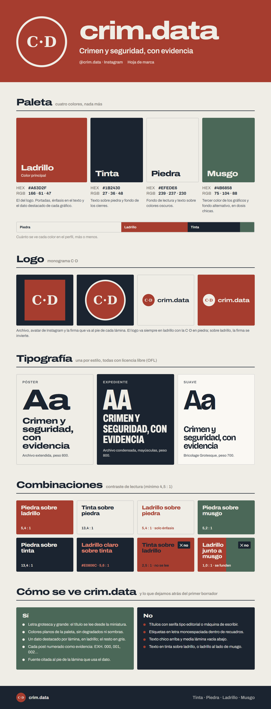

# Marca crim.data

<p align="center"></p>

Todo lo que define cómo se ve **@crim.data** en Instagram. Las plantillas del estudio ya lo aplican solas; esto es para cuando hagan algo fuera del estudio (una historia en Canva, un gráfico en R, una presentación).

## Paleta

| | Color | HEX | RGB | Para qué |
|---|---|---|---|---|
|  | **Ladrillo** (principal) | `#A63D2F` | 166, 61, 47 | El del logo. Portadas, énfasis y el dato destacado de cada gráfico |
|  | **Tinta** | `#1B2430` | 27, 36, 48 | Texto sobre piedra y fondo de los cierres |
|  | **Piedra** | `#EFEDE6` | 239, 237, 230 | Fondo de lectura y texto sobre colores oscuros |
|  | **Musgo** | `#4B6858` | 75, 104, 88 | Tercer color de los gráficos y fondo alternativo, en dosis chicas |

Tonos de apoyo que usan las plantillas: ladrillo claro `#E0806C` (énfasis sobre tinta) y musgo claro `#86AD98` (series sobre tinta).

- **Se leen bien:** piedra sobre ladrillo (5,4:1), tinta sobre piedra (13,4:1), piedra sobre tinta, piedra sobre musgo (5,2:1) y ladrillo sobre piedra solo para énfasis.
- **No se leen:** tinta sobre ladrillo (2,5:1) y ladrillo junto a musgo (1,0:1, se funden).

`paleta.png` es la referencia original con el avatar.

## Logo

| Archivo | Qué es |
|---|---|
| `logo.png` | Monograma C·D en piedra sobre ladrillo, 1080×1080. Sirve de avatar: Instagram lo recorta en círculo |
| `monograma.png` | Solo las letras C·D, en blanco y con fondo transparente. Las plantillas lo usan como máscara para la firma de cada lámina |
| `paleta.png` | La paleta con el avatar |
| `hoja-de-marca.png` | Todo lo de esta página en una imagen |

El logo va siempre en ladrillo con la C·D en piedra. Sobre un fondo ladrillo, la firma se invierte (círculo piedra, letras ladrillo). No se estira, no se le cambian los colores y no lleva sombras.

## Tipografía

Las tres tienen licencia libre (OFL) y están en `fuentes/`. Para usarlas en Canva o Word, instálalas con doble clic.

| Estilo | Letra | Cómo |
|---|---|---|
| Póster | **Archivo** extendida | peso 800, ancho 125 % |
| Expediente | **Archivo** condensada | peso 800, ancho 62 %, mayúsculas |
| Suave | **Bricolage Grotesque** | peso 700 |

## Cómo se ve crim.data

**Sí**
- Letra grotesca y grande: el título se lee desde la miniatura del perfil.
- Colores planos de la paleta, sin degradados ni sombras.
- Un dato destacado por lámina, en ladrillo; el resto en gris.
- Cada post numerado como evidencia: EXH. 000, 001, 002…
- La fuente citada al pie de la lámina que usa el dato.

**No** (lo que dejamos atrás del primer borrador)
- Títulos con serifa tipo editorial o máquina de escribir.
- Etiquetas en letra monoespaciada dentro de recuadros.
- Texto chico arriba y media lámina vacía abajo.
- Texto en tinta sobre ladrillo, o ladrillo al lado de musgo.

## En R

```r
crimdata <- c(ladrillo = "#A63D2F", tinta = "#1B2430", piedra = "#EFEDE6", musgo = "#4B6858")
# ej.: scale_fill_manual(values = unname(crimdata)) + theme(plot.background = element_rect(fill = crimdata["piedra"]))
```

## Cambiar la hoja de marca

La imagen sale de `studio/plantillas/hoja-de-marca.html`. Si cambian algo ahí (o el logo), la regeneran con:

```bash
python -m studio marca
```

Si cambia la paleta, hay que cambiarla también en `studio/plantillas/base.css`, que es la que usan las láminas.
